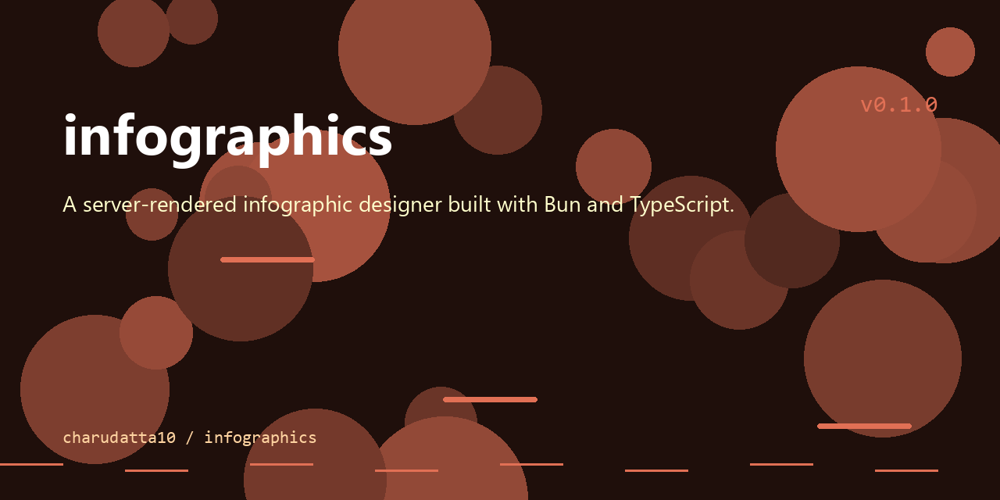

# infographics

<p align="center">
  
</p>

[](https://github.com/chaito10/infographics/actions/workflows/ci.yml)

A server-rendered infographic designer built with Bun and TypeScript.

## What is this?

infographics renders infographics from a lightweight syntax into SVG and PNG. It ships with reusable templates, themes, fonts, and a live preview editor that exports to SVG or PNG files.

## Features

- Live preview editor with debounced rendering
- Built-in templates, themes, and fonts
- Server-side rendering to SVG and PNG
- API endpoints for render, parse, templates, themes, and fonts

## Install / Quickstart

```bash
git clone https://github.com/chaito10/infographics.git
cd infographics
bun install
```

## Usage

```bash
bun run dev    # start the server with file watching
bun run build  # start the server
```

Open http://localhost:3000, type infographic syntax in the editor, and export the result as SVG or PNG.

## Documentation

See [docs/index.md](docs/index.md) for an overview, scripts, and docs structure.

## License

No license has been specified for this project yet.
